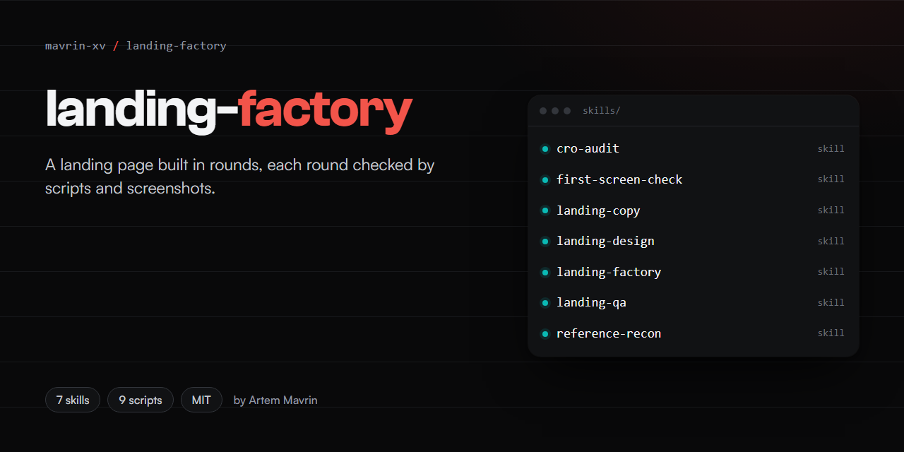

# landing-factory

**Send Claude Code a page you like and an offer; get back a landing page built in rounds, each round checked by scripts and screenshots before you see it.**

"Make it like this site, but for my product" usually ends in one of two ways: a copy of the reference's look that reads as a knock-off, or a generic page with a purple gradient, three equal cards and an invented testimonial. Then come the rounds of feedback, where fixes drift away from what the owner liked and nobody checks the phone view. This pack reverses the reference into a block map, writes the page architecture in the order a skeptic asks questions, applies a design canon and a copy canon, builds mobile first, and runs the same gates every round: copy and design lints, wiring, screenshots at 1440 and 390, a first-screen check and a weighted CRO audit.

  

```bash
git clone https://github.com/mavrin-xv/landing-factory && cd landing-factory
./install.sh                 # skills into ~/.claude/skills (or --project for this project only)
pip install playwright pillow && python3 -m playwright install chromium   # for screenshots
```

<!-- install-notes:start -->
Other ways in: as a Claude Code plugin, run `/plugin marketplace add mavrin-xv/landing-factory` and then `/plugin install landing-factory@landing-factory`. For Codex or another agent that reads `SKILL.md`, copy the folders under `skills/` into its skills directory. On Windows, run `install.sh` from Git Bash or WSL and type `py -3` where these docs say `python3`.
<!-- install-notes:end -->

## What it solves

| Pain | What the pack does |
|---|---|
| "Like this page" turns into a knock-off of its colors and photos | Recon maps every reference block to keep, change or drop; reskin is the default, with a do-not-copy list |
| The page looks generated | A design canon (one written design read, one accent, a visual per section, grids sized to content) and a lint for template tells |
| Nobody understands the offer in five seconds | A copy canon: the buyer's result in the H1, outcome and cost in the sub, one CTA label, skeptic order |
| Invented numbers and testimonials | Copy lint fails any number missing from your facts file |
| It looked fine on a laptop | Screenshots and readable slices at 1440 and 390, overflow, console errors, blank images |
| The ad says one thing, the first screen another | First-screen check at 390x664: promise, H1, CTA, proof, overlays, hero weight, trust faults |
| Feedback rounds drift and break things | A round loop: back up, re-read the reference, map each point, edit, rerun every gate, report point by point |
| "Why doesn't it convert" gets opinions, not an order | A 12-dimension CRO score against the page job, with a hard gate on the first screen and a staged fix list |

## What's inside

| Skill | What it does | Say |
|---|---|---|
| [landing-factory](skills/landing-factory/SKILL.md) | The loop: brief, recon, architecture, copy, build, gates, score, show, next round | "make a landing page like this one", "fix the landing after feedback" |
| [reference-recon](skills/reference-recon/SKILL.md) | Screenshots, tokens, sections and a block map of the reference | "clone this landing", "what does this page do well" |
| [landing-design](skills/landing-design/SKILL.md) | Tokens, mobile-first HTML and CSS, a visual per section, a lint for generated-looking pages | "make it look less AI", "fix the mobile layout" |
| [landing-copy](skills/landing-copy/SKILL.md) | Hero, mechanism, segments, proof and offer copy, linted against facts and scored on a 7-dimension gate | "write the copy", "the hero is weak" |
| [first-screen-check](skills/first-screen-check/SKILL.md) | Seven checks at 390x664 plus a trust-fault scan, one item marked Fix first | "check above the fold", "does the page match the ad" |
| [cro-audit](skills/cro-audit/SKILL.md) | 12 weighted dimensions against the page job, a first-screen gate, quick wins and test ideas | "CRO audit", "why doesn't this page convert" |
| [landing-qa](skills/landing-qa/SKILL.md) | Screenshots and slices at two widths, runtime errors, a wiring gate for anchors, files and CTA counts | "QA the landing", "is anything broken" |

Scripts (Python 3.9+, each with `--help`; the first three need Playwright): `recon.py`, `shot.py`, `first_screen.py`, `ref_map.py`, `gates.py`, `copy_lint.py`, `copy_score.py`, `design_lint.py`, `cro_score.py`.

## Quick start

1. In Claude Code:
   ```
   > make a landing page like https://example.com/tea for our coffee subscription. $16 a bag, ships in 48 hours, cold traffic from Instagram ads. The ad says "Fresh-roasted coffee at your door".
   ```
2. The agent fills the brief with you (price, proof, refund terms: it asks, it does not guess), runs recon, writes `architecture.md`, builds the page from `templates/page/`, runs every gate, and shows round 1 with the 390 screenshots, the gate outputs and the list of placeholders it still needs from you.
3. Send feedback; each next round backs up the previous one and answers your points one by one.

Try it offline on the invented coffee roaster first (no browser needed):

```bash
python3 skills/first-screen-check/scripts/first_screen.py examples/northwind-roasters/site/index.html --promise "fresh-roasted coffee at your door" --static
python3 skills/cro-audit/scripts/cro_score.py examples/northwind-roasters/cro-scores.json
```

The browser runs saved in `examples/northwind-roasters/out/` show the loop: round 1 failed the proof check, round 2 moved the rating into the hero sub:

```
  4 proof       JUDGE no rating, review count or logo text found on the first screen
fix list:
  1. [Fix first] proof: no rating, review count or logo text found on the first screen.
...after round 2:
  4 proof       JUDGE candidates: ['1,240 reviews']
  total 78.3 of 100, grade B, verdict B
```

Every input and every script output of both rounds sits in `examples/northwind-roasters/`.

## How it works

```
 reference URL + brief + facts.md
          |
   reference-recon ------> screenshots, ref-recon.json, reference-map.md
          |
   architecture.md  (page job, design read, sections in skeptic order)
          |
   landing-copy  ----> copy_lint.py, copy_score.py (gate)
          |
   landing-design ---> index.html + site.css from templates/page/, design_lint.py
          |
   landing-qa -------> shot.py (1440, 390), gates.py
   first-screen-check -> first_screen.py (390x664)
   cro-audit --------> cro_score.py (weighted, first-screen gate)
          |
   round report to the owner  -->  feedback  -->  next round (backup first)
```

Details: [docs/architecture.md](docs/architecture.md) and [docs/rubrics.md](docs/rubrics.md).

## Configure

| What | Where |
|---|---|
| The brief (offer, buyer, price, refund, traffic) | `templates/brief-checklist.md` |
| Facts the copy may use, with sources | `facts.md`, from `templates/facts.md` |
| Sections, jobs and visuals per page | `architecture.md`, from `templates/architecture.md` |
| CTA counts, banned strings, stylesheets, new classes per round | `gates.json`, from `templates/gates.json` |
| Copy and CRO scores | `copy-scores.json` and `cro-scores.json` from `templates/` |
| Your own CRO weights | `cro_score.py --weights my-weights.json` |
| Page skeleton and tokens | `templates/page/index.html`, `templates/page/css/site.css` |

## Honest limits

- Tested offline only, on the invented pages in `examples/northwind-roasters/` (a local reference fixture and a local site served on 127.0.0.1). No live reference site was reversed and no page was deployed while building this pack.
- The copy gate and the CRO score are a reviewer's judgement on fixed anchors, not predictions of conversion rate. The CRO weights are a starting rubric that puts the first screen first, not measured effects.
- The lints catch what a script can see (dashes, hype, unsourced numbers, pure black, text-only sections, CTA wiring). Taste, photo quality and whether a quote is real still need a person.
- Screenshots use headless Chromium only. Safari and real phones can differ; check one real device before paid traffic.
- Recon reads the rendered DOM. Pages behind logins, heavy bot protection or canvas-only layouts give thin results.
- Every image in the example is a labelled placeholder, and the example quotes are marked as invented on the page.

## Credits

- Design canon (sections 1, 3 and 6 adapted): https://github.com/Leonxlnx/taste-skill (MIT, Copyright (c) 2026 Leonxlnx); license text in [THIRD_PARTY_NOTICES.md](THIRD_PARTY_NOTICES.md).
- Landing page modes, the first-screen check idea and copy gate dimensions: inspired by https://github.com/boringmarketer/boring-marketing-skills (MIT).
- Reskin versus replica and the asset ladder: inspired by https://github.com/ericosiu/ai-marketing-skills (MIT).
- Page type first, CRO dimension order and quick wins: inspired by https://github.com/coreyhaines31/marketingskills (MIT).
- Render the page and check it by eye: inspired by https://github.com/abi/screenshot-to-code (MIT).
- Repo and skill layout: modelled on https://github.com/anthropics/skills and https://github.com/obra/superpowers (MIT).

The build-round loop, the lessons and the scripts come from the authors' own landing page work; no outside code was copied. From the projects above, ideas only, apart from the adapted canon text credited first.

## Contributing

See [CONTRIBUTING.md](CONTRIBUTING.md). Agents working on the repo: [AGENTS.md](AGENTS.md).

<!-- author:start -->
## Author

Built and maintained by [Artem Mavrin](https://github.com/mavrin-xv). This repo is one of a set of agent skill packs for marketing and operations work. Each one installs on its own; the full list is in [agent-skill-packs](https://github.com/mavrin-xv/agent-skill-packs). If a pack saved you an afternoon, a star helps other people find it.
<!-- author:end -->

## License

MIT. See [LICENSE](LICENSE).
